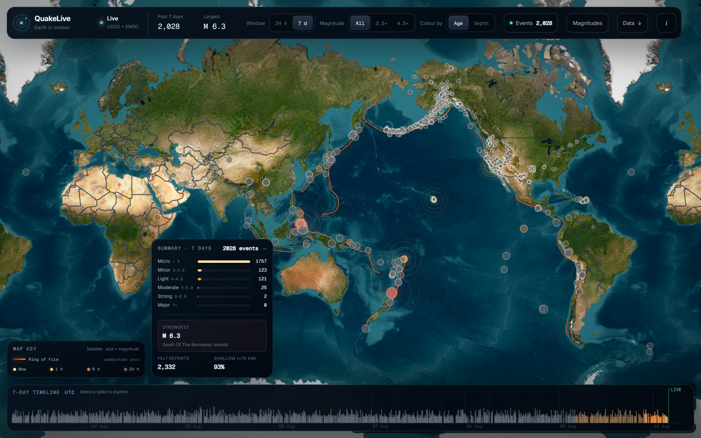
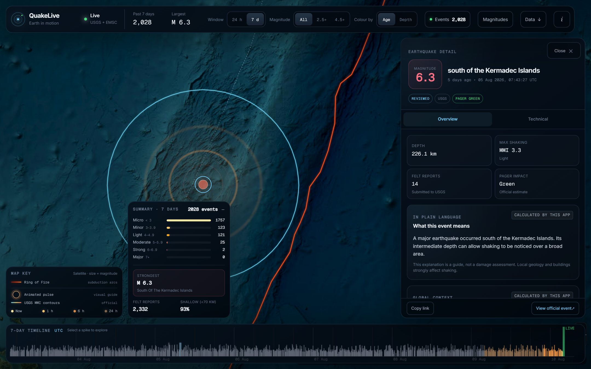
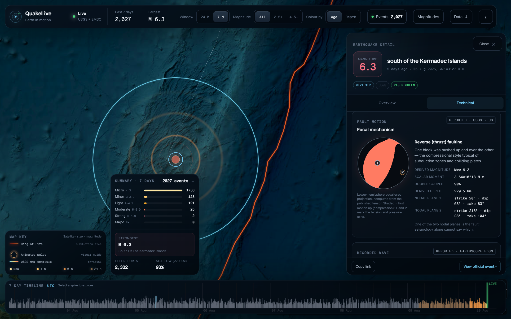
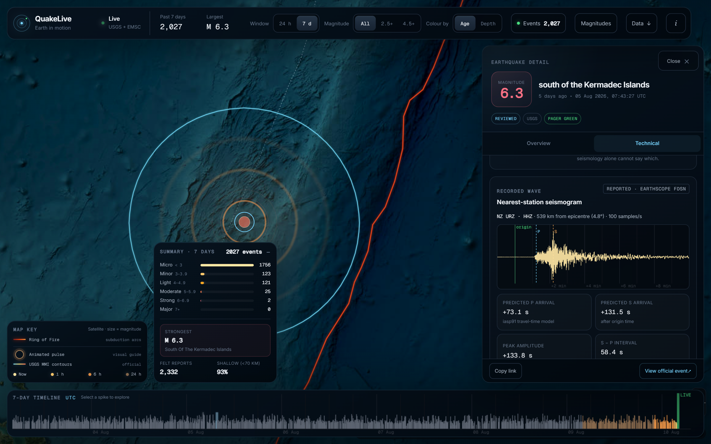
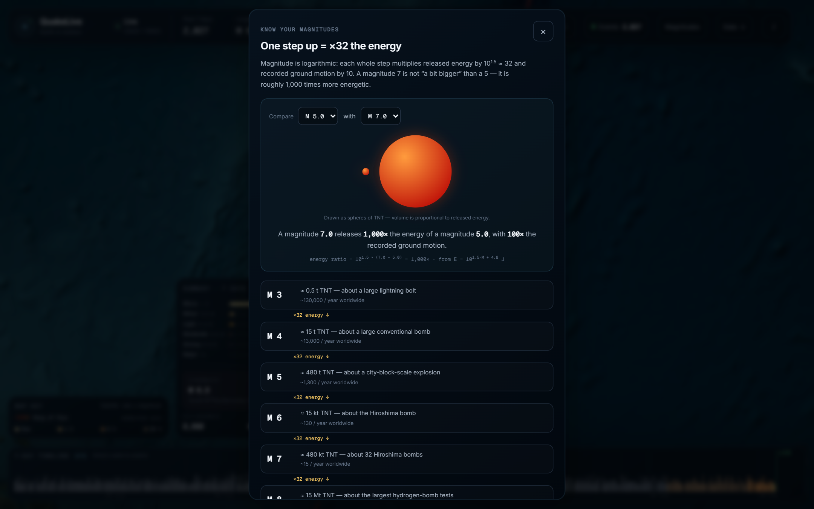
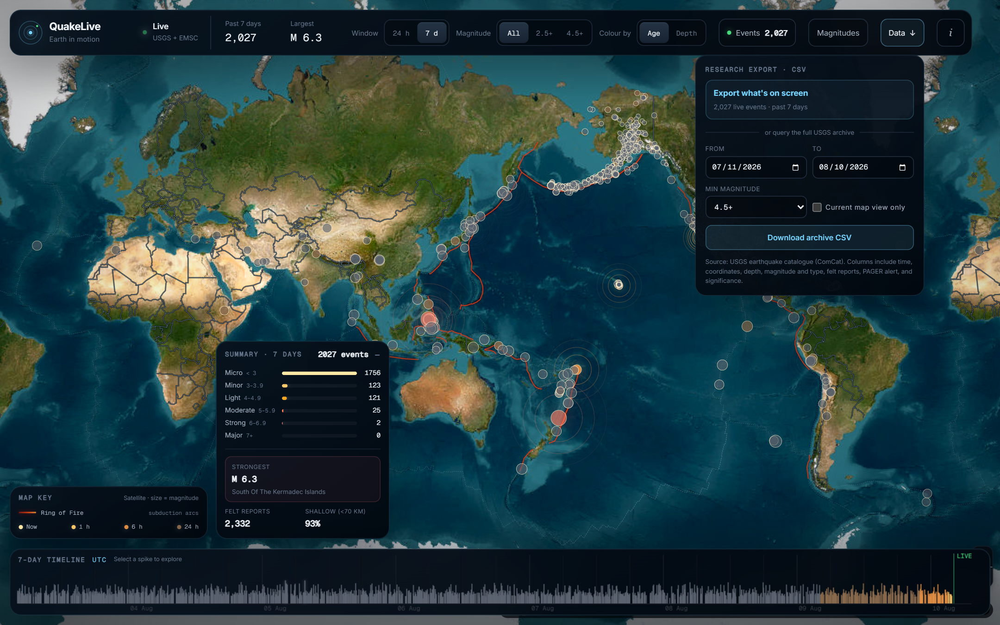

<div align="center">

# 🌍 QuakeLive

**Earth in motion — a live, open-source earthquake explorer.**

Every earthquake on the planet on a satellite map, within about a minute of the seismic
networks publishing it — with the science shown, not just the dots.

[](LICENSE)
[](https://github.com/Bijaykars/QuakeLive/pulls)
[](https://react.dev)
[](https://www.typescriptlang.org/)
[](https://maplibre.org/)
[](https://vite.dev)



</div>

---

## ✨ What it does

- 🔴 **Live global feed** — the USGS feed is polled every minute and merged with EMSC's
  real-time WebSocket push, so new earthquakes toast on screen seconds after publication.
  Records are enriched and revised as networks review them, and every revision is tracked.
- 🔥 **Ring of Fire** — the Pacific subduction arcs burn with an animated deep-red ember
  effect (plate boundaries after Bird, 2003).
- 📊 **Seismic summary** — magnitude-class breakdown, strongest event, felt reports and
  shallow-event share over a 24-hour or 7-day window.
- 🕐 **24 h / 7 d timeline** — a scrubbable strip of every event; click a spike to fly there.

## 🔎 Every event, explained

Click any dot and QuakeLive explains it twice: once in plain language, once for engineers.

| Overview | Technical |
| --- | --- |
| Plain-language summary, depth, felt reports, PAGER alert | Full source record (stations, azimuthal gap, RMS…) |
| Official USGS ShakeMap MMI contours drawn on the map | ShakeMap ground-motion curves (PGA, PGV, SA, ±σ) |
| Radiated energy with TNT and Hiroshima equivalents | Focal mechanism "beachball" from the moment tensor |
| "How common is this size?" global rarity context | Nearest-station seismogram with P/S arrivals |
| Rupture-length estimate (Wells–Coppersmith) | CSV / PNG download of the waveform |



### ⚪⚫ Focal mechanism, computed exactly

The beachball is not a clip-art approximation: every pixel evaluates the P-wave radiation
sign **γᵀ·M·γ** from the published moment tensor in a lower-hemisphere equal-area
projection, so nodal lines emerge exactly where the physics puts them — including
non-double-couple components. Validated against the USGS-published T/P/N principal axes.



### 📈 The actual wave

For any event, QuakeLive finds the nearest open seismic station in the EarthScope/IRIS
FDSN archive and draws the real vertical-channel waveform: predicted P and S arrivals
(iasp91), peak-shaking time, and the classic S−P single-station distance check.
Both the raw samples (CSV with metadata header) and the plot (PNG) are downloadable.



### 📐 Know your magnitudes

An interactive explainer of the logarithmic scale: pick two magnitudes and see them drawn
as spheres of TNT (volume ∝ energy), with the calculation shown —
one whole step = 10¹·⁵ ≈ **32× the energy** and 10× the ground motion.



### 📥 Research export

One click exports what's on screen; or query the full USGS ComCat archive (complete back
to ~1900) by date range, magnitude and map extent — 18 research-ready CSV columns that
open straight into pandas, R or Excel.



## 🚀 Getting started

```bash
git clone https://github.com/Bijaykars/QuakeLive.git
cd QuakeLive
npm install
npm run dev
```

Other commands:

```bash
npm run build      # typecheck + production build to dist/
npm run preview    # serve the production build
npm run test:identity                                  # EMSC→USGS event-identity merge check
QA_URL=http://localhost:4173 npm run test:interaction  # headless interaction sweep (Chrome/Edge)
```

## ☁️ Hosting

QuakeLive is a fully static single-page app — **no backend, no API keys, no environment
variables**. All data (USGS, EMSC, EarthScope) is fetched by the visitor's browser from
public CORS-enabled APIs, so a hosted copy is exactly as live as a local one.

| Host | Setup |
| --- | --- |
| **Vercel** | Import the repo → framework *Vite* → build `npm run build`, output `dist` |
| **Netlify** | Build `npm run build`, publish directory `dist` |
| **GitHub Pages** | Publish `dist` (set Vite `base` when serving from `/QuakeLive/`) |

## 🛠️ Tech

React 19 · TypeScript (strict) · Vite · MapLibre GL · Zustand · Tailwind CSS 4 —
no UI framework, no chart library; the timeline, seismogram and beachball are hand-drawn
canvas.

## 🗂️ Data sources & attribution

| Data | Source |
| --- | --- |
| Earthquake catalogue & live feeds | [USGS Earthquake Hazards Program](https://earthquake.usgs.gov/) |
| Real-time preliminary events | [EMSC SeismicPortal](https://www.seismicportal.eu/) |
| Waveforms, station metadata, travel times | [EarthScope (IRIS) FDSN web services](https://service.earthscope.org/) |
| Satellite imagery | Esri, Vantor, Earthstar Geographics, and the GIS community |
| Map detail | [OpenFreeMap](https://openfreemap.org/) / OpenStreetMap contributors |
| Plate boundaries | Bird (2003) |

## 🤝 Contributing

Issues and pull requests are welcome — bug reports, feature ideas, translations, science
corrections. Please keep the provenance labelling honest: everything shown is tagged as
*reported*, *calculated*, or *educational estimate*, and new features should do the same.

## ⚠️ Disclaimer

QuakeLive is informational only — **not** an earthquake warning, detection, or prediction
service. Data may be incomplete or revised by the source networks. Always follow official
civil-protection guidance.

## 📄 License

[MIT](LICENSE)
